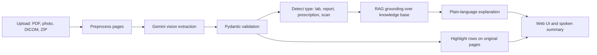

# Pixelab Report

**An LLM app that reads medical reports and explains them in plain English, Hindi or Hinglish, highlighting every result on the user's own pages.**

> Demo screenshots : 

## Why I built it
I built it for my dad. He used to depend on other people to explain his reports. I wanted a tool that could explain them in simple language and mark the abnormal values, while telling him to talk to a doctor. Then I used the project to learn how to make it reliable: validation, retrieval-grounded explanations and an evaluation set.

## What it does
- **Reads messy input:** lab PDFs, scanned PDFs, phone photos (JPG, PNG, WEBP, HEIC), prescriptions, radiology reports, DICOM scans and ZIPs of scan files.
- **Highlights on the original pages:** red outside the printed range, green inside, blue for listed medicines. Boxes are validated and snapped to the real text line in digital PDFs.
- **Explains in three languages:** English, Hindi or Hinglish, with a spoken summary in Hindi or English.
- **Cites its notes:** each lab explanation shows which knowledge-base entry it used.
- **Handles scans carefully:** raw MRI, CT and X-ray images get a general description only, never a diagnosis.

## How it works

1. **Preprocess:** auto-rotate photos, boost contrast, sharpen, and render image-only PDF pages at a higher resolution.
2. **Extract:** pages are sent to Gemini in parallel and come back as JSON. Every reply is validated with Pydantic (`schemas.py`). Bad rows are dropped and counted instead of crashing the page. Failed calls retry with backoff and a timeout.
3. **Ground (RAG):** each lab test is matched to `kb/tests.json` by name or alias first, then by embedding similarity (`rag.py`). The explanation may use only the matched notes.
4. **Explain and highlight:** the model writes the explanation; the app draws highlights on the original pages.

## Design decisions
| Decision | Why |
|---|---|
| Drop invalid rows, do not fail the page | One malformed row should not lose a whole report. Dropped rows are counted so quality stays visible. |
| Alias match before embeddings | Common names (Hb, SGPT, FBS) match exactly and cost nothing. Embeddings only handle the rest. |
| Explanations limited to retrieved notes | Reduces made-up medical claims and lets the UI show a source. |
| Reports kept in memory, deleted after 30 minutes | Nothing is written to disk. Logs never contain report text. |
| Per-IP rate limit and upload limits | Protects the API quota. ZIP files are size-checked before unpacking. |
| Not deployed publicly | Strangers could upload real patient data to a free-tier API key. I chose to show it by demo video and local run instead. |

## Evaluation
`python -m evaluation.run_eval` runs the real pipeline on labelled reports and measures recall, value accuracy, status accuracy, latency and tokens. If a model fails to answer, the run is flagged `degraded` or `unavailable` instead of printing a misleading score.

| Model | Cases | Recall | Value accuracy | Status accuracy | Avg seconds per case |
|---|---|---|---|---|---|
| gemini-3.5-flash-lite | 4 synthetic | 1.00 | 1.00 | 1.00 | 4.5 |
| [second model] | [rerun] | [ ] | [ ] | [ ] | [ ] |
| gemini-3.5-flash-lite on real reports | [N] | [ ] | [ ] | [ ] | [ ] |

The 4 synthetic cases are clean and easy, so they show the pipeline works, not that it is accurate on real documents. Real-report results go in the last row.

One real 67-item lab report ran end to end in about 31 seconds (about 36.7k tokens), including 3 automatic retries after temporary API errors.

## Limitations
- The knowledge base has 26 tests, was written by me, and needs review and cited sources before real use.
- Raw scan images get a general description only. AI cannot read them like a radiologist.
- Evaluation is small and mostly synthetic so far.
- State lives in one process, so it runs as a single instance.

## Next steps
Expand the knowledge base with cited sources, evaluate on more real de-identified reports, tune the retrieval threshold with the evaluation set, and add persistent storage.

## Tech stack
Python, FastAPI, Gemini API (vision and embeddings), Pydantic, PyMuPDF, Pillow, pydicom, NumPy, gTTS, pytest, GitHub Actions, Docker, vanilla JavaScript.

## Run it locally
```
py -3.12 -m venv .venv
.\.venv\Scripts\Activate.ps1          # Mac/Linux: source .venv/bin/activate
python -m pip install -r requirements.txt -r requirements-dev.txt
copy .env.example .env                 # Mac/Linux: cp .env.example .env
# add your GEMINI_API_KEY to .env
python -m uvicorn main:app --reload
```
Open http://127.0.0.1:8000. Never commit `.env`.

```
python -m pytest                        # 11 offline unit tests
python -m evaluation.make_samples       # create synthetic labelled reports
python -m evaluation.run_eval           # run the evaluation
```
`GET /api/metrics` shows token use, errors and average latency.

## Project structure
```
main.py          API, ingestion, extraction, highlighting
schemas.py       Pydantic models for model output
rag.py           retrieval over the knowledge base
metrics.py       token, latency and error counters
kb/tests.json    knowledge-base notes
evaluation/      scoring, runner, synthetic sample generator
tests/           unit tests
static/          web interface
```

## Disclaimer
Pixelab Report is a learning project, not medical advice. It does not diagnose or recommend treatment. Please consult a qualified doctor about your results.

*Built with help from AI coding tools. [Add one sentence on what you wrote, changed or debugged yourself.]*
